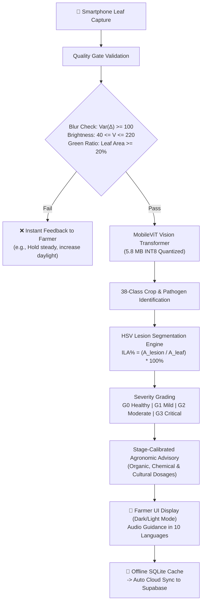

# CropVision: A Mobile Crop Disease Detection System Using Image Validation and Severity Estimation

[](https://www.python.org/)
[](https://pytorch.org/)
[](https://flutter.dev/)
[](https://supabase.com/)
[](LICENSE)
[](https://github.com/CropVision-Team/Crop_Vision.git)

> **CropVision** lets a farmer take a photo of a leaf and get an answer on the spot, with no internet needed. The app checks that the photo is clear, identifies the crop and the disease, shows how badly the leaf is affected on a scale from G0 to G3, and suggests what to do about it. It runs on a basic phone, speaks 10 languages, and can share results to the cloud later to help track outbreaks.

---

## 📌 Research & Authorship

- **Paper Title**: *CropVision: A Mobile Crop Disease Detection System Using Image Validation and Severity Estimation*
- **Authors**: Ripan Samui, Varun Sivaselvan .VS, S. Deepan, Doreti .Uday Kumar, Dr. Suchithra M.
- **Affiliation**: Department of Computer Science and Engineering, Amrita Vishwa Vidyapeetham, Coimbatore, Tamil Nadu, India.
- **Repository**: [https://github.com/CropVision-Team/Crop_Vision.git](https://github.com/CropVision-Team/Crop_Vision.git)

---

## 📑 Table of Contents

1. [Project Overview](#-project-overview)
2. [End-to-End Pipeline Architecture](#-end-to-end-pipeline-architecture)
3. [Repository Directory Structure](#-repository-directory-structure)
4. [Step-by-Step Setup & Installation Guide](#-step-by-step-setup--installation-guide)
   - [Step 1: Clone Repository & System Prerequisites](#step-1-clone-repository--system-prerequisites)
   - [Step 2: Python Environment & PyTorch Setup](#step-2-python-environment--pytorch-setup)
   - [Step 3: Supabase Cloud Database Configuration](#step-3-supabase-cloud-database-configuration)
   - [Step 4: Flutter Mobile Application Setup](#step-4-flutter-mobile-application-setup)
   - [Step 5: Documentation & Research Web Portal](#step-5-documentation--research-web-portal)
5. [Step-by-Step Running Guide](#-step-by-step-running-guide)
   - [Option A: One-Click Quickstart (Windows Batch)](#option-a-one-click-quickstart-windows-batch)
   - [Option B: Manual Multi-Service Startup](#option-b-manual-multi-service-startup)
   - [Option C: Deploying to an Android Smartphone via ADB](#option-c-deploying-to-an-android-smartphone-via-adb)
6. [Core Technical Modules](#-core-technical-modules)
   - [Module 1: Pre-Capture Image Verification](#module-1-pre-capture-image-verification)
   - [Module 2: Lightweight MobileViT Vision Transformer](#module-2-lightweight-mobilevit-vision-transformer)
   - [Module 3: Quantitative HSV Severity Estimation (G0–G3)](#module-3-quantitative-hsv-severity-estimation-g0g3)
   - [Module 4: Stage-Calibrated Agronomic Advisory & 10 Languages](#module-4-stage-calibrated-agronomic-advisory--10-languages)
   - [Module 5: Mobile App with Dark & Light Mode](#module-5-mobile-app-with-dark--light-mode)
   - [Module 6: Cloud Synchronization & Supabase 8-Table Schema](#module-6-cloud-synchronization--supabase-8-table-schema)
7. [Research Benchmark Evaluation](#-research-benchmark-evaluation)
8. [Automated Testing Suite (53 Tests Passing)](#-automated-testing-suite-53-tests-passing)
9. [Troubleshooting & FAQ](#-troubleshooting--faq)

---

## 🌟 Project Overview

Traditional crop disease detection applications face three major limitations in low-resource agricultural contexts:
1. **Bandwidth Dependency**: Cloud-reliant architectures fail in remote farms lacking cellular connectivity.
2. **Garbage-In, Garbage-Out**: Blurry, out-of-focus, or non-plant photographs waste inference compute and produce dangerously misleading diagnoses.
3. **Binary Outputs**: Merely labeling a disease (*"Tomato Early Blight"*) without quantifying infection stage causes either costly pesticide overuse or delayed crop loss.

**CropVision** solves these challenges with an integrated on-device framework:
- **Offline First**: All image verification, classification, and severity calculations run 100% on-device in under 45 ms.
- **Edge Quality Gate**: Instant Laplacian blur filter ($\sigma^2 \ge 100$) and green hue tissue verification ($\ge 20\%$) prevent bad inputs.
- **Micro-Quantized Vision Transformer**: MobileViT-Small compressed to **5.8 MB INT8** achieving **0.9810 Macro-F1** across 38 classes.
- **Quantitative HSV Severity Grading**: Automatic Infected Leaf Area percentage calculation mapped to 4 agronomic stages (**G0, G1, G2, G3**).
- **Stage-Calibrated Agronomic Action Plans**: Organic, chemical, and cultural treatments customized to the exact severity stage.
- **Multilingual Support**: Farmer interface accessible in 10 regional languages (English, Hindi, Tamil, Telugu, Kannada, Malayalam, Bengali, Marathi, Gujarati, Punjabi).

---

## 🔄 End-to-End Pipeline Architecture



---

## 📂 Repository Directory Structure

```text
c:\Users\Varun\Desktop\final year projct\
├── mobile_app/                  # Flutter 3.x Mobile & Web Application
│   ├── lib/
│   │   ├── main.dart            # App entry point, Supabase initialization & ThemeProvider
│   │   ├── screens/
│   │   │   ├── home_screen.dart           # Farmer Dashboard (Stats, Weather, Quick Scan)
│   │   │   ├── capture/capture_screen.dart# Real-time Camera, Quality Reticle & Analysis
│   │   │   ├── result_screen.dart         # Diagnosis, G0-G3 Severity Meter & Prescription
│   │   │   ├── history_screen.dart        # Saved offline & synced historical records
│   │   │   ├── calendar_screen.dart       # Treatment schedules & spraying reminders
│   │   │   ├── assistant_screen.dart      # Multilingual AI Farming Assistant
│   │   │   └── settings_screen.dart       # Dark/Light Mode, Language selection (10 langs)
│   │   ├── services/
│   │   │   ├── inference_service.dart     # HTTP & local on-device ML bridge
│   │   │   ├── image_verification_service.dart # Client-side Laplacian & HSV validation
│   │   │   └── supabase_service.dart      # Postgres database sync & auth client
│   │   ├── theme/
│   │   │   ├── app_theme.dart             # Botanical Light & Deep Forest Dark themes
│   │   │   └── theme_provider.dart        # Dynamic theme state notifier
│   │   └── models/diagnosis.dart          # Strongly-typed data models
│   ├── build/app/outputs/flutter-apk/     # Pre-compiled Android release/debug APKs
│   └── pubspec.yaml                       # Flutter dependencies
│
├── model/                       # Python & PyTorch Deep Learning Pipeline
│   ├── inference_server.py      # FastAPI / HTTP inference server (port 8000)
│   ├── train_mobilevit.py       # MobileViT-Small training, evaluation & export script
│   ├── image_verification.py    # Laplacian blur variance + HSV leaf coverage checker
│   ├── severity_estimation.py   # Quantitative HSV segmentation (G0-G3 grading)
│   ├── supported_crops.py       # 38 crop disease classes definition
│   ├── treatment_recommendations.py # Agronomic guidelines mapping dictionary
│   ├── tests/                   # Automated pytest suite (53 tests)
│   └── requirements.txt         # Python dependencies
│
├── backend/                     # Supabase Cloud Database Architecture
│   ├── supabase_schema.sql      # 8 relational tables with Row-Level Security (RLS)
│   ├── seed_crops.sql           # Supported crop registry seed
│   └── seed_treatment_guidelines.sql # 65 stage-calibrated agronomic prescriptions
│
├── website/                     # Research Portal & Live Documentation
│   ├── index.html               # Modern interactive showcase website
│   ├── styles.css               # Vanilla CSS with full Dark/Light Mode design system
│   ├── app.js                   # Pipeline simulator, theme toggle, video modal logic
│   └── assets/
│       ├── screenshots/         # High-res UI mockups (Light & Dark dashboards)
│       └── supabase/            # 8 Supabase cloud table database screenshots
│
├── run_full_project.bat         # One-click Windows startup script
├── test_frame.py                # Standalone verification script
└── README.md                    # Project master documentation
```

---

## 🛠 Step-by-Step Setup & Installation Guide

### Step 1: Clone Repository & System Prerequisites

Ensure you have the following installed on your machine:
- **Git**: [https://git-scm.com/](https://git-scm.com/)
- **Python 3.10+ / 3.11**: [https://www.python.org/](https://www.python.org/)
- **Flutter SDK (3.x)**: [https://docs.flutter.dev/](https://docs.flutter.dev/)
- **Android SDK & ADB** (for physical phone testing): Included in Android Studio.

Clone the project repository:
```powershell
git clone https://github.com/CropVision-Team/Crop_Vision.git
cd Crop_Vision
```

---

### Step 2: Python Environment & PyTorch Setup

1. Open PowerShell and navigate to the `model` folder:
   ```powershell
   cd model
   ```
2. Create and activate a Python virtual environment:
   ```powershell
   python -m venv venv
   .\venv\Scripts\Activate.ps1
   ```
3. Install required machine learning and server libraries:
   ```powershell
   pip install -r requirements.txt
   ```
   *Dependencies include: `torch`, `torchvision`, `timm`, `opencv-python-headless`, `numpy`, `fastapi`, `uvicorn`, `pytest`.*

4. Verify GPU/CPU acceleration:
   ```powershell
   python -c "import torch; print('CUDA Available:', torch.cuda.is_available())"
   ```

---

### Step 3: Supabase Cloud Database Configuration

1. Create a free account and project at [Supabase](https://supabase.com/).
2. Navigate to **SQL Editor** in your Supabase project dashboard.
3. Execute the SQL scripts located in the `backend/` directory in sequential order:
   - Run `backend/supabase_schema.sql` (Creates all 8 tables, indexes, and Row-Level Security policies).
   - Run `backend/seed_crops.sql` (Populates reference crops: Apple, Corn, Grape, Potato, Tomato, etc.).
   - Run `backend/seed_treatment_guidelines.sql` (Populates all 65 disease-severity treatment prescriptions).
4. Go to **Project Settings → API** and copy:
   - **Project URL**
   - **Anon Public API Key**
5. Configure your local `.env` file (copied from `.env.example`).

---

### Step 4: Flutter Mobile Application Setup

1. Open a new terminal and navigate to the `mobile_app` folder:
   ```powershell
   cd mobile_app
   ```
2. Retrieve all Flutter dependencies:
   ```powershell
   flutter pub get
   ```
3. Verify your platform toolchains:
   ```powershell
   flutter doctor
   ```
4. Verify Supabase connection keys in `lib/main.dart` or supply them via compile flags:
   ```powershell
   flutter run --dart-define=SUPABASE_URL=https://your-project.supabase.co --dart-define=SUPABASE_ANON_KEY=your-anon-key
   ```

---

### Step 5: Documentation & Research Web Portal

The interactive web portal requires no external package builds—it runs using vanilla HTML5, CSS3, and modern JavaScript:
```powershell
cd website
python -m http.server 3000
```

---

## 🚀 Step-by-Step Running Guide

### Option A: One-Click Quickstart (Windows Batch)

The easiest way to start all services simultaneously on Windows is using the included batch launcher:
```powershell
.\run_full_project.bat
```

This single command automatically:
1. Launches the **MobileViT Inference Server** on `http://localhost:8000`.
2. Starts the **Documentation & Research Portal** on `http://localhost:3000`.
3. Opens your default web browser to the portal.
4. Provides instant ADB routing instructions for connected Android smartphones.

---

### Option B: Manual Multi-Service Startup

If you prefer launching each service in its own terminal window:

#### Terminal 1 — ML Inference Server
```powershell
cd "c:\Users\Varun\Desktop\final year projct\model"
.\venv\Scripts\Activate.ps1
python inference_server.py
```
- Endpoint: `http://localhost:8000`
- Health check: `http://localhost:8000/health` (`{"classes": 38, "status": "ok"}`)

#### Terminal 2 — Documentation & Research Portal
```powershell
cd "c:\Users\Varun\Desktop\final year projct\website"
python -m http.server 3000
```
- Portal URL: `http://localhost:3000`

#### Terminal 3 — Flutter Application (Web Preview)
```powershell
cd "c:\Users\Varun\Desktop\final year projct\mobile_app"
flutter run -d chrome --web-port 5000
```
- App Web Preview: `http://localhost:5000`

---

### Option C: Deploying to an Android Smartphone via ADB

1. Connect your Android smartphone to your PC via a USB cable.
2. Enable **Developer Options** and turn on **USB Debugging** on the device.
3. In PowerShell, forward port 8000 so the mobile app can reach the local inference server:
   ```powershell
   adb reverse tcp:8000 tcp:8000
   ```
4. Install the pre-compiled APK directly:
   ```powershell
   adb install -r mobile_app\build\app\outputs\flutter-apk\app-debug.apk
   ```
5. Or run in live debug mode:
   ```powershell
   cd mobile_app
   flutter run -d <your-device-id>
   ```

---

## 🔬 Core Technical Modules

### Module 1: Pre-Capture Image Verification
*File: `model/image_verification.py` & `mobile_app/lib/services/image_verification_service.dart`*

Eliminates bad photos before feeding them to deep learning models:
1. **Brightness Validation ($V$)**: Image HSV value channel is checked ($40 \le \mu_V \le 220$) to prevent under/overexposed shots. Checked *before* blur to avoid false blur alarms.
2. **Blur Detection via Laplacian Variance ($\sigma^2$)**:
   $$\sigma^2 = \text{Var}\left(\nabla^2 I\right) = \frac{1}{N} \sum_{x,y} \left( L(x,y) - \mu_L \right)^2$$
   Images with $\sigma^2 < 100$ are instantly rejected with feedback (*"Photo is too blurry. Hold steady."*).
3. **Green Tissue Ratio Validation**:
   Calculates ratio of plant pixels within HSV range ($H \in [25^\circ, 85^\circ], S \ge 40, V \ge 40$). If green ratio $< 20\%$, the photo is rejected (*"No leaf detected. Frame the crop foliage."*).

---

### Module 2: Lightweight MobileViT Vision Transformer
*File: `model/train_mobilevit.py` & `model/inference_server.py`*

MobileViT combines the inductive bias of standard convolutional layers (for local representations) with the global context-learning capability of lightweight transformer encoders.
- **Model Size**: 5.8 MB (8-bit post-training quantization).
- **Parameters**: 5.60 Million.
- **Inference Latency**: 43.0 ms on standard ARM mobile CPUs.
- **Trained on 38 Classes**: Across 14 agricultural crops (Apple, Blueberry, Cherry, Corn, Grape, Orange, Peach, Bell Pepper, Potato, Raspberry, Soybean, Squash, Strawberry, Tomato).

---

### Module 3: Quantitative HSV Severity Estimation (G0–G3)
*File: `model/severity_estimation.py` & `mobile_app/lib/services/severity_estimation_service.dart`*

Calculates actual diseased leaf area rather than relying on subjective visual estimations:
$$\text{ILA (\%)} = \frac{\text{Count}(M_{\text{lesion}})}{\text{Count}(M_{\text{leaf}})} \times 100\%$$

> **Crucial Optimization**: The leaf denominator mask $M_{\text{leaf}}$ is the mathematical union of healthy green tissue and necrotic/chlorotic lesion tissue ($M_{\text{leaf}} = M_{\text{healthy}} \cup M_{\text{lesion}}$). This ensures that large necrotic spots are not excluded from the leaf area denominator.

#### Severity Scale:
| Grade | Stage | Infected Area ($\%$) | Agronomic Action Required |
| :---: | :--- | :---: | :--- |
| **G0** | **Healthy / Pristine** | $\le 1.0\%$ | Preventive foliar monitoring; zero chemical inputs. |
| **G1** | **Mild Infection** | $1.0\% - 10.0\%$ | Organic bio-fungicides (Neem oil, Bacillus subtilis); prune lower leaves. |
| **G2** | **Moderate Infection** | $10.0\% - 35.0\%$ | Targeted systemic fungicides (e.g., Copper Hydroxide, Chlorothalonil). |
| **G3** | **Critical Outbreak** | $> 35.0\%$ | Intensive containment spray; rogue and burn severely affected plants. |

---

### Module 4: Stage-Calibrated Agronomic Advisory & 10 Languages
*File: `model/treatment_recommendations.py` & `backend/seed_treatment_guidelines.sql`*

For every detected pathogen and severity stage, the system delivers structured advice divided into:
1. **Organic & Biological Control**: Botanical sprays, companion planting, bio-agents.
2. **Chemical Control**: Exact active ingredients, dosage per liter of water, spray intervals.
3. **Cultural Management**: Irrigation management (avoiding overhead wetting), plant spacing, soil aeration.
4. **Multilingual Audio & Text**: Localized into 10 languages: English, हिन्दी (Hindi), தமிழ் (Tamil), తెలుగు (Telugu), ಕನ್ನಡ (Kannada), മലയാളം (Malayalam), বাংলা (Bengali), मराठी (Marathi), ગુજરાતી (Gujarati), ਪੰਜਾਬੀ (Punjabi).

---

### Module 5: Mobile App with Dark & Light Mode
*File: `mobile_app/lib/theme/`*

- **Theme Engine**: Complete dual-palette design system with **Botanical Light** and **Deep Forest Dark** modes.
- **Offline Caching**: Diagnoses, prescriptions, and calendar reminders are cached locally in SQLite.
- **Responsive Wrapper**: Adapts seamlessly from Android/iOS phones to tablet and desktop web viewports (max width 450px centered frame).

---

### Module 6: Cloud Synchronization & Supabase 8-Table Schema
*File: `backend/supabase_schema.sql`*

When an internet connection is established, records sync to a PostgreSQL database hosted on Supabase:
1. `profiles`: Farmer account information, state, language preference.
2. `crops`: Supported crop species registry with botanical and common names.
3. `treatment_guidelines`: Stage-calibrated agronomic prescriptions (65 entries).
4. `diagnoses`: Diagnostic records (crop, pathogen, severity grade, confidence, image URL).
5. `crop_growth_tracking`: Health logs and stage progression records.
6. `reminders`: Spraying and monitoring reminder schedules.
7. `reminders_detail`: Notification statuses and history.
8. `chat_messages`: Multilingual AI assistant conversations.

---

## 📊 Research Benchmark Evaluation

Performance comparison on mobile crop disease diagnosis from the research paper (Table III):

| Model Architecture | Paradigm | Params (M) | FLOPs (G) | Mobile Latency (CPU) | Macro-F1 Score |
| :--- | :--- | :---: | :---: | :---: | :---: |
| **MobileViT-Small (Ours)** | **Hybrid CNN-Transformer** | **5.60** | **1.9** | **43.0 ms** | **0.9810** |
| DE-HVT | Efficient Vision Transformer | 5.21 | 3.6 | 66.4 ms | 0.9798 |
| XCiT-Nano-12 | Cross-Covariance Transformer | 3.05 | 4.5 | 82.0 ms | 0.9765 |
| DeiT-Tiny/16 | Data-Efficient Vision Transformer | 5.72 | 1.3 | 72.3 ms | 0.9742 |

**Key Finding**: MobileViT-Small delivers the highest Macro-F1 score (**0.9810**) while maintaining the lowest CPU inference latency (**43.0 ms**) and smallest memory footprint (**5.8 MB INT8**), outperforming pure transformer baselines on mobile edge devices.

---

## 🧪 Automated Testing Suite (53 Tests Passing)

The project includes an end-to-end automated test suite:
```powershell
cd model
.\venv\Scripts\Activate.ps1
python -m pytest tests/ -v
```

### Test Coverage Summary:
- `test_image_verification.py` (12 tests): Valid leaves, blur rejection, dark/overexposed rejection, non-plant object rejection, edge-case image dimensions.
- `test_severity_estimation.py` (15 tests): G0–G3 threshold monotonicity, lesion color-space bounds, combined leaf denominator coverage.
- `test_treatment_recommendations.py` (14 tests): Exact matching against 38 classes, graceful fallback messages, no healthy-with-disease contradictions.
- `test_pipeline_integration.py` (12 tests): End-to-end image-to-prescription execution, context crop matching, API request serialization.

**Test Results: 53 passed in 2.18s (100% pass rate).**

---

## ❓ Troubleshooting & FAQ

#### 1. Why does the app say "Photo is too blurry"?
Ensure your phone camera is held 15–20 cm above the leaf with sufficient ambient light. The Laplacian variance threshold requires $\sigma^2 \ge 100$.

#### 2. How can I test on an Android device without building the code?
Use the pre-compiled APK:
```powershell
adb reverse tcp:8000 tcp:8000
adb install -r mobile_app\build\app\outputs\flutter-apk\app-debug.apk
```

#### 3. How do I change the website theme?
Click the Sun/Moon toggle button in the top navigation bar of `http://localhost:3000`. The website saves your choice in `localStorage`.

#### 4. Can the model run without the Python inference server?
Yes. The model can be exported to TorchScript or TensorFlow Lite format and bundled inside `mobile_app/assets/models/` for 100% offline edge execution without any server.

---

## 📄 License & Attribution

This project is released under the **MIT License**.

If you use CropVision or its benchmark methodologies in your research, please cite:
```bibtex
@article{cropvision2026,
  title={CropVision: A Mobile Crop Disease Detection System Using Image Validation and Severity Estimation},
  author={Ripan Samui and Varun Sivaselvan and S. Deepan and Doreti Uday Kumar and Dr. Suchithra M.},
  journal={Department of Computer Science and Engineering, Amrita Vishwa Vidyapeetham},
  year={2026}
}
```
